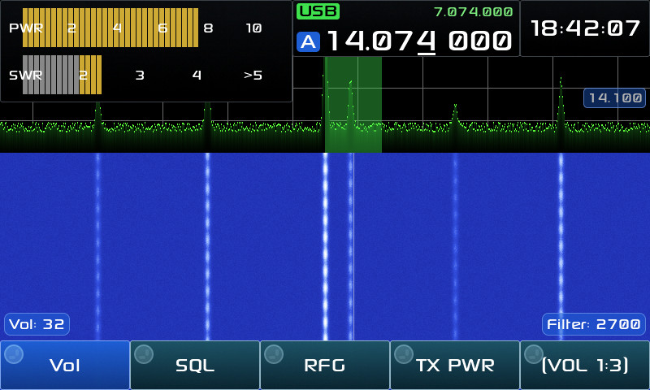
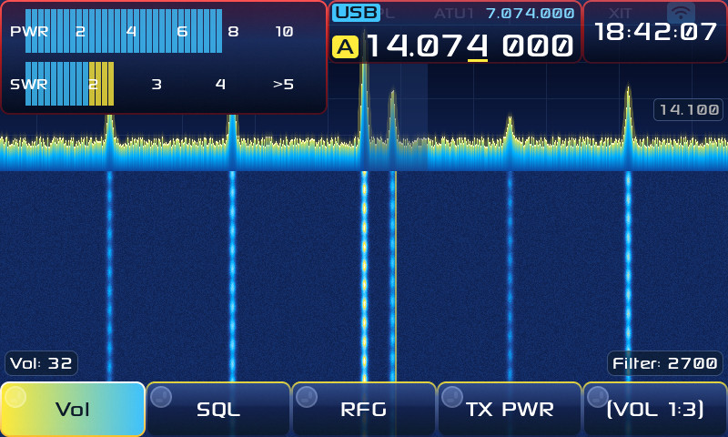
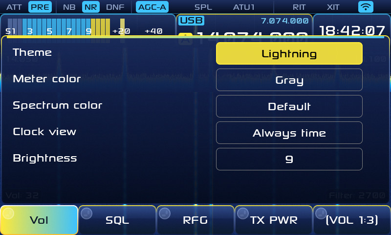
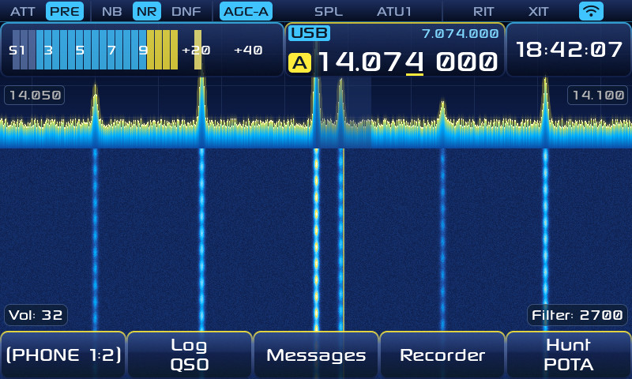
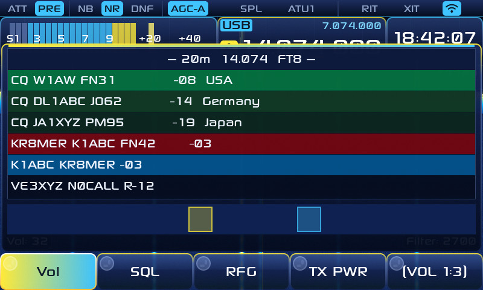
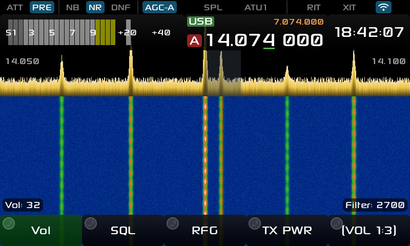
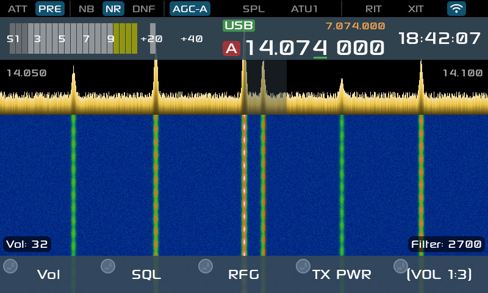

# X6100 LVGL GUI — KR8MER Lightning Edition

This fork by **KR8MER** adds the **Lightning** theme (Settings → Theme), styled
after the EAS Station Lightning theme: storm-navy panels, electric-yellow and
cyan edges, a glowing scope-style spectrum, gradient buttons and menus, a red
flash on key-down, and a KR8MER boot logo and splash. On start-up a bolt of
lightning strikes the logo, a spark runs along it and a second bolt lands as you
are greeted by your callsign; the bolts are drawn fresh every boot. Lightning is
the default on a fresh install. Settings → UI → Clock time zone (and an optional second zone)
changes the time the clock shows; the radio's own clock stays on UTC.

**Operating, after [Nexus](https://github.com/kd9taw/Nexus):**

* **Cockpits** (APP → page 1): Phone, CW, Digital and RTTY. Entering one sets the
  radio up for that way of operating: Phone picks LSB below 10 MHz and USB above
  (USB on 60 m) and follows the band; CW turns on the decoder; Digital opens FT8
  in USB-D; RTTY opens the RTTY panel in LSB-D. Phone and CW bring their own
  button pages (Log, Messages, Recorder, Hunt and the controls for that mode).
* **Log any QSO** (Log QSO button): band, frequency, mode and 59/599 come from
  the radio. Same log as FT8. Export ADIF writes the whole log to
  `qso_log.adi` on the DATA partition, with POTA references as `SIG`/`SIG_INFO`.
* **POTA hunter** (Hunt POTA button, needs Wi-Fi): live activator spots,
  filtered by band and mode, with NEW on parks not yet in your log. HUNT tunes,
  opens the right cockpit, and tags your next QSO with that activator with the
  park. Spots are only read, only while the window is open, at most every 90 s.
  SOTA is not included: the SOTA API's terms require prior approval for
  AI-written software. Images are on this fork's
[Releases](https://github.com/KR8MER/x6100_gui/releases) page.

Built on the X6100 GUI by R1CBU and the OpenX6100 contributors.

**Time:** Settings → General → Time server picks the internet time server
(NIST, Google, Cloudflare or a regional pool); the clock is set from it at once
and on every Wi-Fi connect. The X6100 has no GPS receiver inside, but a USB GPS
(one that shows up as `/dev/ttyACM0`, as most u-blox dongles do) is used by the
radio's time daemon whatever server is chosen, and its fix shows in APP → GPS.

## Screenshots

The home screen in the Lightning theme, and the original look it replaces (still
there: Settings → Theme → Simple):

| Lightning | Original (Simple) |
|---|---|
|  |  |

**What is different, and what is not.** Lightning is a theme: the layout, the
buttons, the knobs and everything the screen shows are the same as the original,
in the same places. What changes is how it is drawn:

* panels are storm-navy gradients with thin yellow and cyan edges, where the
  original has flat grey and black
* the spectrum is a cyan-to-yellow trace with a soft glow over a faint grid,
  where the original fills it solid yellow; the waterfall runs blue to white
  instead of blue through green to orange
* the S-meter is cyan, the VFO badge yellow, and the selected button a
  yellow-to-cyan gradient (the original uses green and red)
* when you transmit, the edges turn red and pulse

If you like the original look, pick Simple (or Black or Flat) in Settings →
Theme; the cockpits, log, POTA hunter, time zones and time server all work the
same in every theme.

**Factory** (Settings → Theme → Factory) is styled after the radio's stock
firmware: a black screen, a bright green trace over a grey level grid with a
green passband block, a royal blue waterfall, blue readout boxes and flat teal
buttons. Only the colours follow the stock screen; the layout is this GUI's.

| Factory | Factory, transmitting |
|---|---|
|  |  |

| Transmitting | Settings |
|---|---|
|  |  |

| Cockpit picker (APP, page 1) | Phone cockpit |
|---|---|
|  |  |

| Log QSO | POTA hunter |
|---|---|
|  |  |

| FT8 | SWR scan |
|---|---|
|  |  |

| Two time zones on the clock | Black and Flat themes |
|---|---|
|  |   |

The start-up splash, frame by frame:


These are drawn off the radio with this firmware's own theme and drawing code
and sample data (the call signs, spots and log entries are examples). To take
real ones, set a long press (Settings → UI) to Screenshot; they are saved to the
DATA partition.


This is part of an alternative firmware for X6100 using the LVGL library

## Installing

Open [Releases](https://github.com/gdyuldin/x6100_gui/releases/latest) page and download `sdcard.img` file (in Assets section). With balenaEtcher or Rufus
burn img file to microSD card. Insert card to the transceiver and boot it.

## Importing ADI log

Application could mark already worked callsign in the UI.
To load information about previous QSOs - copy your ADI log to the `DATA` partition and rename it to `incoming_log.adi`.
Application will import records to own log on the next boot and will rename `incoming_log.adi` to `incoming_log.adi.bak`.

*Note*: `DATA` partition will be created after first launch transceiver with inserted SD card.


## Exporting ADI log

Application stores FT8/FT4 QSOs to the `ft_log.adi` file on the `DATA` partition of SD card. This file might be used to load QSOs to online log.


## Building


* Clone repositories

```
mkdir x6100
cd x6100
git clone https://github.com/gdyuldin/AetherX6100Buildroot
git clone https://github.com/gdyuldin/x6100_gui
```

* Build buildroot

```
cd AetherX6100Buildroot
git submodule init
git submodule update
./br_config.sh
cd build
make
cd ../..
```

* Build app

```
cd x6100_gui
git submodule init
git submodule update
cd buildroot
./build.sh
```
