# KR8MER Lightning Edition — User Guide

This guide covers what the KR8MER Lightning Edition adds to the X6100 LVGL GUI
(R1CBU and the OpenX6100 contributors), as of **v1.0.2-kr8mer.7**. Everything
the original GUI does is still here and works as before; this guide only
explains the parts that are new or different.

Contents:

1. [Installing](#1-installing)
2. [Start-up](#2-start-up)
3. [Finding your way around](#3-finding-your-way-around)
4. [Themes](#4-themes)
5. [Cockpits](#5-cockpits)
6. [Logging QSOs](#6-logging-qsos)
7. [POTA hunting](#7-pota-hunting)
8. [DX cluster](#8-dx-cluster)
9. [Space weather](#9-space-weather)
10. [Clock and time zones](#10-clock-and-time-zones)
11. [Setting the time: internet time server and GPS](#11-setting-the-time-internet-time-server-and-gps)
12. [The tuner](#12-the-tuner)
13. [Files on the DATA partition](#13-files-on-the-data-partition)
14. [Screenshots from the radio](#14-screenshots-from-the-radio)
15. [Troubleshooting](#15-troubleshooting)
16. [The radio's web page](#16-the-radios-web-page)

---

## 1. Installing

1. Open the [Releases](https://github.com/KR8MER/x6100_gui/releases) page and
   download `sdcard.<version>.img.zip` from the newest release.
2. Unzip it, and write the `.img` file to a microSD card with balenaEtcher or
   Rufus.
3. Put the card in the radio and power it on.

On the first boot a `DATA` partition is created on the card. Your settings,
your log and anything you copy for the radio live there, and it is kept when
you write a newer image (see [Files on the DATA partition](#13-files-on-the-data-partition)).

## 2. Start-up

The KR8MER boot logo appears while Linux starts, then the splash plays for
about three seconds:

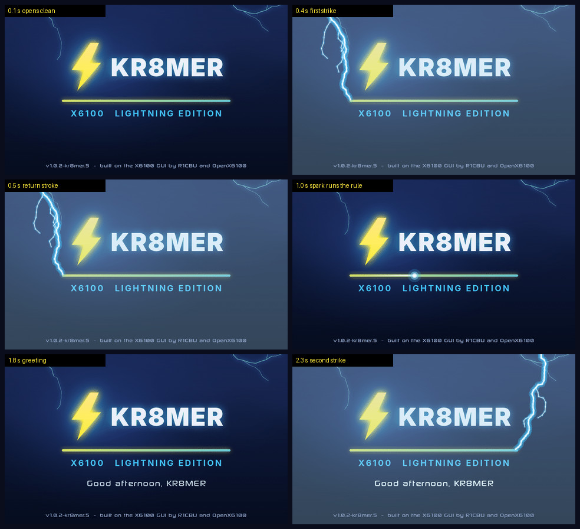

* a bolt of lightning strikes the left end of the accent line
* a spark of charge runs along it
* you are greeted by the call sign set on the radio (APP → page 3 → Callsign),
  by time of day in your clock's time zone — "Good morning", "Good afternoon",
  "Good evening", or "Late night on the bands" after 11 pm
* a second bolt strikes the far end, and the splash fades into the main screen

The bolts are drawn fresh every boot. Before the clock has been set the
greeting just says "Welcome back".

## 3. Finding your way around

The layout is the same as the original GUI. The five buttons under the screen
change with the page you are on; the leftmost one names the page, for example
`(APP 1:4)` is page 1 of 4 of the APP pages. Press it to go to the next page.

| Front-panel key | Opens |
|---|---|
| **APP** | page 1: the cockpits (Phone, CW, Digital, RTTY) · page 2: RTTY, FT8, SWR Scan, GPS · page 3: Recorder, QTH, Callsign, Settings · page 4: WiFi, Bluetooth, **Log QSO**, **Hunt POTA** · page 5: **DX Cluster**, **Space Weather** |
| **GEN**, **KEY**, **MSG**, **DFN**, **DFL** | as in the original GUI |

**Long presses.** Each front-panel key (GEN, APP, KEY, MSG, DFN, DFL) can be
given a long-press action in **Settings → Interface**. As well as the original
choices (Screenshot, Recorder, Mute, Voice mode, Battery info, the APP
windows), you can choose **Phone cockpit**, **CW cockpit**, **Digital
cockpit**, **RTTY cockpit**, **Log QSO**, **POTA hunter**, **DX cluster** and **Space weather** — handy for
getting to the log with one press.

Settings has four tabs: **General**, **Interface**, **Voice** and **Info**.

## 4. Themes

**Settings → Interface → Theme** chooses how everything is drawn. The layout,
buttons and controls are the same in every theme; only the look changes.

| Theme | Look |
|---|---|
| **Lightning** (default) | After the EAS Station Lightning theme: storm-navy gradient panels with yellow and cyan edges, a glowing cyan-to-yellow spectrum over a faint grid, a blue-to-white waterfall, a yellow-to-cyan selected button. The edges turn red and pulse while you transmit. |
| **Factory** | After the radio's stock firmware: black screen, bright green trace over a grey grid with a green passband block, royal blue waterfall, blue readout boxes, flat teal buttons. |
| **Simple** | The original GUI's default look. |
| **Black**, **Flat** | The original GUI's other two looks. |

| Lightning | Factory | Simple |
|---|---|---|
| 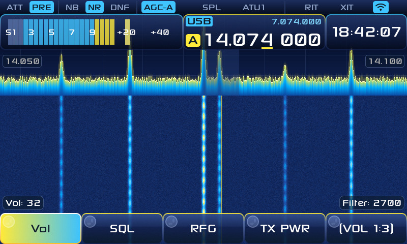 | 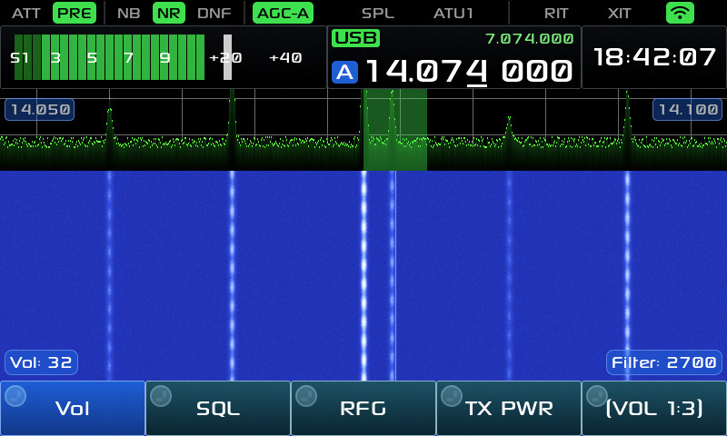 | 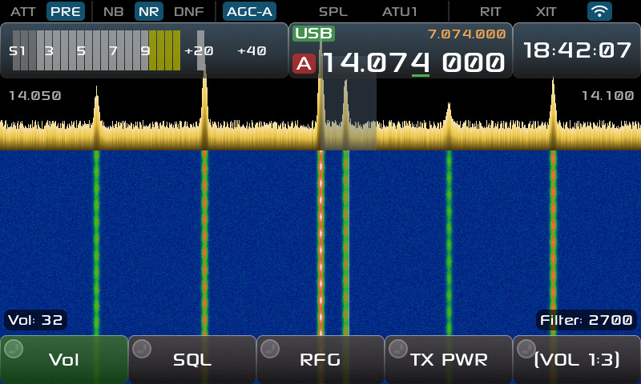 |

The original colour options still apply on top of any theme: **Custom spectrum
color** / **Spectrum Color** and **Meter Color** (Settings → Interface).

## 5. Cockpits

A cockpit sets the radio up for one way of operating in a single press:
**APP → page 1**, then **Phone**, **CW**, **Digital** or **RTTY**.

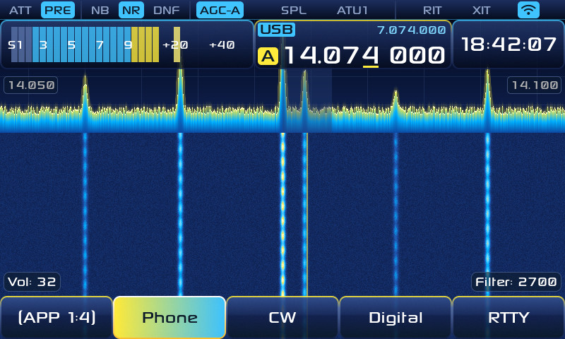

| Cockpit | What it does |
|---|---|
| **Phone** | Picks the sideband for the band: LSB below 10 MHz, USB above, and USB on 60 m. As you tune to another band it follows (LSB on 40 m, USB on 20 m). If you pick the other sideband by hand it stays until you change band; AM and FM are never changed. Brings up the Phone buttons. |
| **CW** | CW mode with the CW decoder on. Brings up the CW buttons. |
| **Digital** | USB-D and opens FT8. |
| **RTTY** | LSB-D and opens the RTTY panel. |

**Phone buttons** — page 1: Log QSO, Messages, Recorder, Hunt POTA · page 2:
compressor, internal and hand mic gain, TX power.

**CW buttons** — page 1: Log QSO, Messages, key speed, CW decoder · page 2:
Hunt POTA, key tone, CW peak filter, key volume.

**Messages** opens the message keyer for the current mode (CW memories in CW,
voice messages in phone).

## 6. Logging QSOs

**Log QSO** (APP → page 4, or the Phone and CW cockpit buttons) logs a contact
in any mode. It is the same log FT8 writes to.

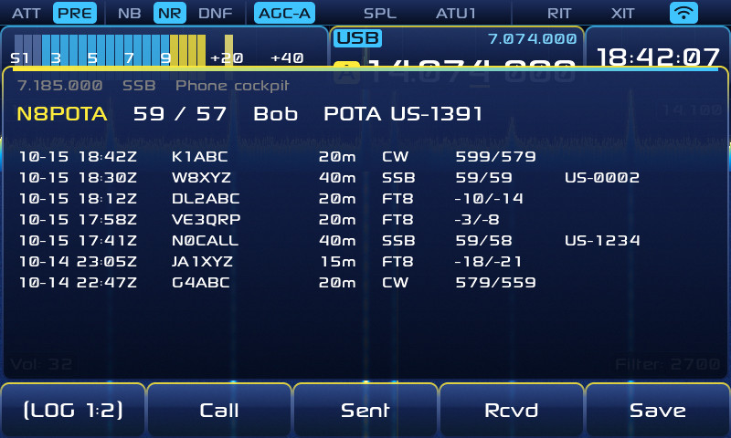

The top line shows the frequency, mode and cockpit, taken from the radio. Under
it is the entry being made, and below that your most recent QSOs.

| Button | Does |
|---|---|
| **Call** | Type the other station's call sign. |
| **Sent**, **Rcvd** | Change the reports. They start at 599 in CW and RTTY, and 59 otherwise. |
| **Save** | Logs the QSO with the band, frequency, mode and UTC time from the radio. |
| page 2: **Name** | The other operator's name (optional). |
| page 2: **Park / Summit** | A POTA park (e.g. `US-1234`) or SOTA summit reference, if the other station is portable there. Filled in for you when you are hunting (below). |
| page 2: **Export ADIF** | Writes the whole log to `qso_log.adi` on the DATA partition now. The radio also rewrites that file after every QSO it saves (FT8 and FT4 included), so it is always current. Park and summit references go in as `SIG` / `SIG_INFO` (and `SOTA_REF`), ready for LoTW, QRZ, the POTA site or a desktop logger. |
| page 2: **Clear** | Clears the entry. |
| page 3: **HamQTH Login** | Your HamQTH.com user name and password, for call sign look-up. |
| page 3: **QRZ Key** | Your QRZ Logbook API key, for uploading QSOs to QRZ. |
| page 3: **Upload QRZ** | Sends every QSO not yet on QRZ (up to 200 per press; the message says how many are left). |
| page 3: **Look up** | Looks the call up on HamQTH again. |

Saving the same call at the same time twice logs it once.

Typing in these windows: turn the knob to move across the on-screen keys and
press it to type the highlighted key (a USB keyboard works too).

**Call sign look-up (HamQTH).** With a HamQTH login set, entering a call looks
it up: the name is filled in (if you have not typed one) and the station's
QTH, country and grid show at the top right, credited to HamQTH.com. The grid
is saved with the QSO. HamQTH is free, but you need your own account
(register at hamqth.com). Lookups only happen when the call changes or you
press Look up.

**QRZ Logbook upload.** With a QRZ key set, each QSO you save is sent to your
QRZ logbook straight away, and the screen says *"QRZ: uploaded"*, *"QRZ:
already in your logbook"* or why it failed. QRZ only allows uploads with an
**XML (or higher) subscription**; the key is in your logbook's settings on
qrz.com. The radio never overwrites a QSO already in your QRZ logbook (so it
cannot replace a confirmed one). **Upload QRZ** sends what has not gone yet,
including your FT8 QSOs and anything logged before you set the key.

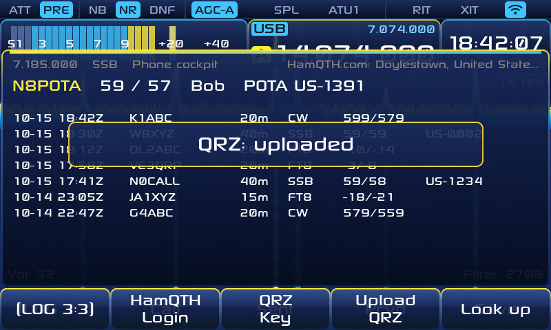

The password and key are shown only as you type them (the key afterwards as its
last 4 characters), but they are stored in the radio's settings file,
`params.db` on the DATA partition, which anyone with the SD card can read on a
computer.

You can also set the callsign, grid, HamQTH login, QRZ key and time server
from a phone or computer: see [The radio's web page](#16-the-radios-web-page).

## 7. POTA hunting

**Hunt POTA** (APP → page 4, or the cockpit buttons) lists the stations
activating parks right now, from the POTA spot feed at pota.app. It needs
Wi-Fi.

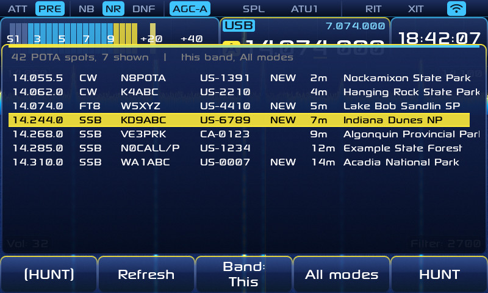

Each row shows frequency, mode, activator, park reference, a mark, how long
ago it was spotted, and the park's name. The mark is **NEW** for a park not yet
in your log, and **WKD** when you have already logged that activator at that
park today (UTC) — POTA counts one contact per activator, park and day, so a
second one would be a dupe.

| Button | Does |
|---|---|
| **Refresh** | Fetches the spots again. While the window is open the list is refreshed every 90 seconds. |
| **Band: This / All** | Only spots on the band you are on, or all bands. |
| mode filter | All modes, CW, Phone or Data. |
| **HUNT** | Pick a spot with the knob, then HUNT: the radio tunes to it, enters the right cockpit (CW, Phone or Digital; FT8 or FT4 to match the spot) and remembers the activator and park. |

When you then log a QSO with that activator, in any mode, the park reference is
filled in for you and the screen shows *"Logged K1ABC at US-1234"*. A hunt
tags one QSO only, matches the activator however their call is written
(`W1AW/P` matches `W1AW`), and expires after four hours, so an old reference
never lands on an unrelated contact. QSOs imported later from an ADIF file are
never tagged.

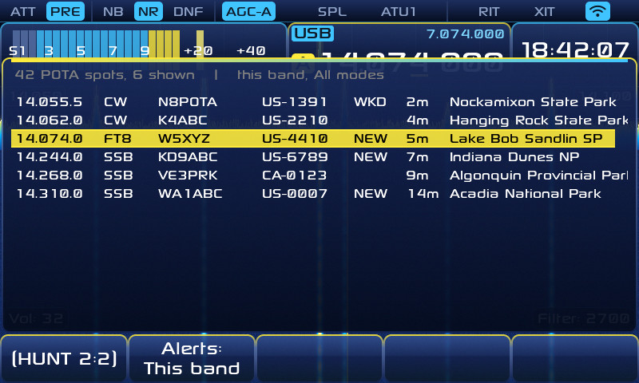

**Alerts** (Hunt POTA, page 2): *Off*, *This band* or *All bands*. When on,
the radio checks the spots every 5 minutes in the background and shows a
message such as *"New park: K1ABC US-1234 14.062 CW"* for parks not yet in
your log. Each activation is announced once, and nothing is fetched while the
hunter window is open or while alerts are off. It needs Wi-Fi.

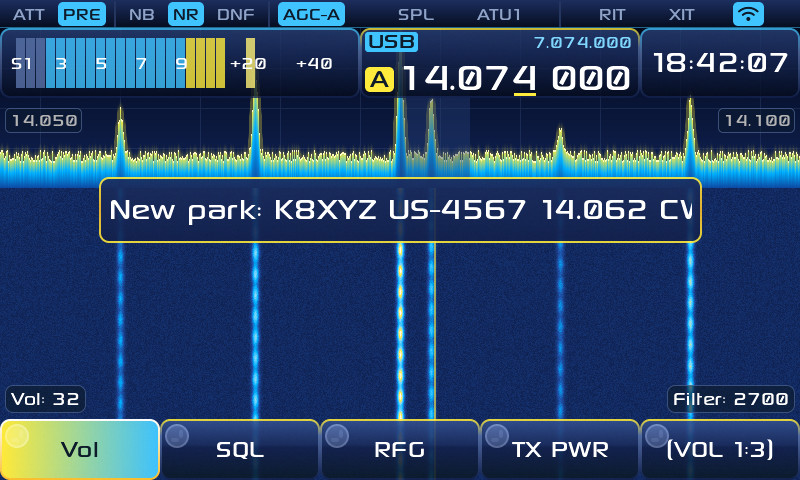

**SOTA** is not included: the SOTA API's terms require approval before
software written with AI assistance may use it.

## 8. DX cluster

**DX Cluster** (APP → page 5) lists the latest DX cluster spots — stations
other operators have just heard — from HamQTH.com. It needs Wi-Fi; no account
is needed.

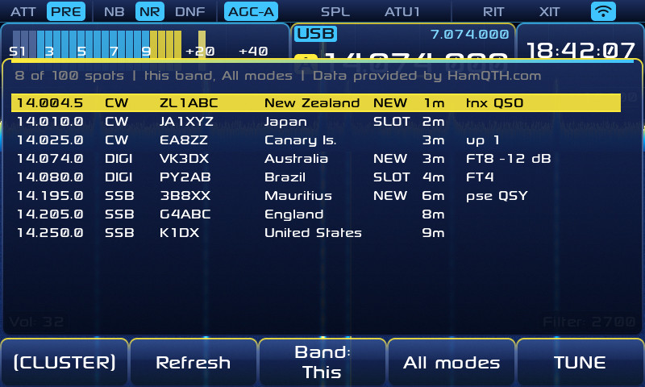

Each row shows frequency, mode (CW, SSB or DIGI as spotted), the DX station,
its country, a mark, how long ago it was spotted, and the spotter's comment.
The mark is **NEW** if you have never logged that station, **SLOT** if you
have, but not on this band and mode, and blank if you have.

| Button | Does |
|---|---|
| **Refresh** | Fetches again. The list also refreshes by itself every 30 seconds while the window is open; HamQTH asks for no more than one request every 15 seconds, so Refresh waits if pressed sooner. |
| **Band: This / All** | Only spots on the band you are on, or all bands. |
| mode filter | All modes, CW, Phone or Data. |
| **TUNE** | Pick a spot with the knob, then TUNE: the radio tunes to it and enters the CW or Phone cockpit for CW and SSB spots, or the Digital cockpit with FT8 or FT4 when the comment says which. Other spots are just tuned. |

Spots are data provided by HamQTH.com.

## 9. Space weather

**Space Weather** (APP → page 5) shows the numbers that decide HF conditions,
from NOAA's Space Weather Prediction Center:

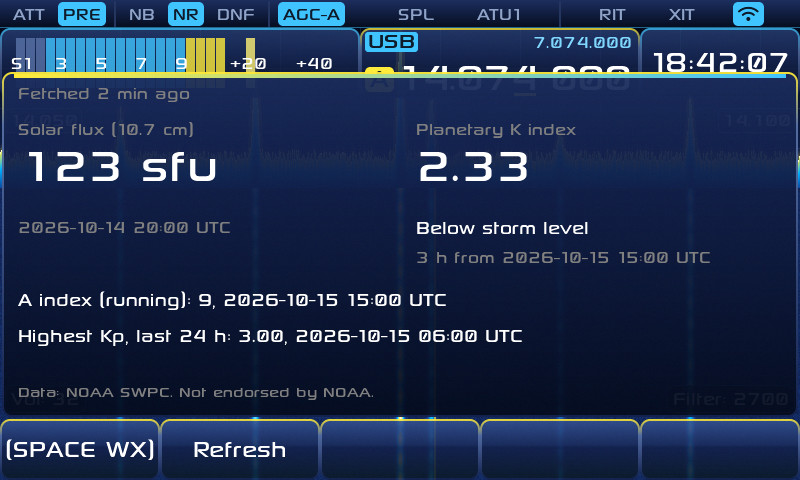

* **Solar flux** (10.7 cm, in sfu) — higher generally means the higher bands
  open.
* **Planetary K index** — geomagnetic activity, 0 to 9, with NOAA's storm
  level when there is one (G1 Minor from Kp 5 up to G5 Extreme at Kp 9).
  High K means noisy, unsettled bands.
* the running **A index**, and the highest Kp of the last 24 hours.

Each value shows its time (UTC). The data is kept for 15 minutes; **Refresh**
fetches again (at most once a minute). Data: NOAA SWPC, public domain; NOAA
does not endorse this radio.

## 10. Clock and time zones

The radio's own clock always runs on UTC (FT8 and your log need that). What
the clock on screen shows is up to you, in **Settings → Interface**:

* **Clock time zone** — the zone the clock shows.
* **Second time zone** — optionally a second zone underneath, for example UTC
  and your local time together.

Zones: UTC, US Eastern, US Central, US Mountain, Arizona, US Pacific, Alaska,
Hawaii, Atlantic, Newfoundland, UK / Ireland, Central Europe, Eastern Europe,
Moscow, India, China, Japan, Sydney, Auckland, Brazil and South Africa.
Daylight saving time changes by itself for the US/Canada, Europe, Australia
and New Zealand rules.

## 11. Setting the time: internet time server and GPS

**Internet time.** When the radio joins Wi-Fi it sets its clock from an
internet time server and keeps it right from then on. **Settings → General →
Time server** chooses which one:

* **Default** — time.nist.gov on connect, then the pool.ntp.org servers
* time.nist.gov, time.google.com, time.cloudflare.com
* the North America, Europe, Asia or Oceania pool
* **Custom…** — type any host name or address, for example a home NTP server
  or a GPS-disciplined Raspberry Pi (letters, digits, dots and dashes only)

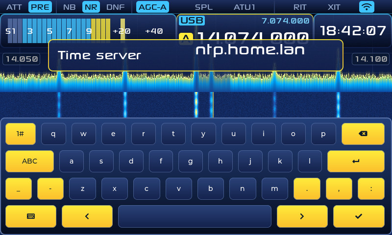

Picking one sets the clock from it straight away. You will see *"Clock set
from …"*, or *"Can't reach … (Wi-Fi on?)"* if it could not be reached, in which
case the clock is left as it was. If the time is set but cannot be saved to
the radio's clock chip, it says so (the time is then lost at power-off).

**GPS.** The X6100 has no GPS receiver inside. A USB GPS that shows up as
`/dev/ttyACM0` (most u-blox USB dongles do) is picked up by the radio's time
service, whatever time server you choose, and its position shows in
**APP → page 2 → GPS**. The time from a GPS is useful in the field with no
Wi-Fi, for FT8 especially.

**By hand.** Settings → General → *Day, Month, Year* and *Hour, Min, Sec* set
the clock directly (in UTC).

## 12. The tuner

**What the radio reports.** While you transmit, the top block shows output
power and SWR. The base board reports SWR and power (and ALC) to the GUI.

**What it does not report.** The radio does not measure or report the
tuner's capacitance or inductance, or the antenna's impedance (resistance and
reactance). The tuner reports only whether it has tuned, and a coded setting
of its relays. Xiegu has not published how that code maps to inductor and
capacitor values, so it cannot be shown as microhenries or picofarads. SWR is
a single number: it tells you how good the match is, not what the impedance
is.

**The raw setting.** What the radio can show, it does: after each tune the
screen says *"Tuned: network 0x…"*, **Settings → Info** shows the setting saved
for the frequency you are on, and every tune is added to `atu_log.csv` on the
DATA partition (time, antenna, frequency, the setting in hex and in bits).
Tuning into known loads and comparing the bits is how its meaning can be
worked out.

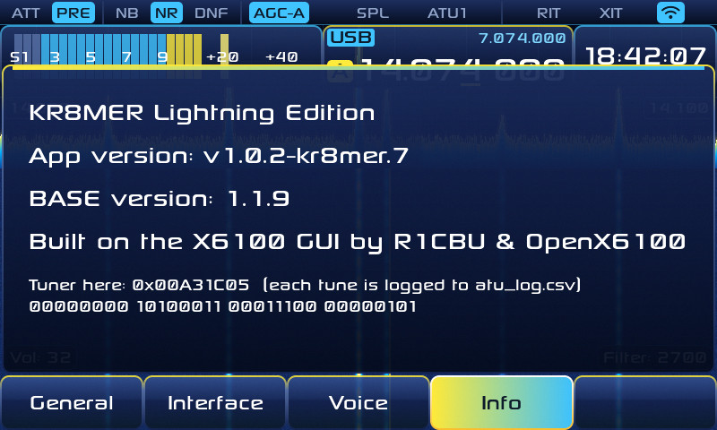

**Tuner memory.** Each successful tune is remembered, per antenna and
frequency. When you come back within 25 kHz of a remembered tune, it is put
back at once, without tuning again. The **ATU** label in the top row shows the
state: lit when the tuner is on; in its "no saved tune here" style when there
is no remembered tune near this frequency yet; greyed out when a transverter
is in use.

**SWR Scan** (APP → page 2) sweeps a band and draws SWR against frequency,
which shows where an antenna is resonant and how wide its usable range is:

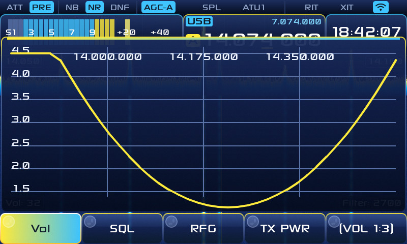

## 13. Files on the DATA partition

The `DATA` partition on the SD card can be read and written from a computer.

| File | What it is |
|---|---|
| `qso_log.adi` | Your whole log in ADIF, rewritten after every QSO (and by **Log QSO → Export ADIF**). |
| `ft_log.adi` | FT8/FT4 QSOs, written as they are made (as in the original GUI). |
| `incoming_log.adi` | Copy an ADIF log here under this name to import it at the next boot (it is then renamed `incoming_log.adi.bak`). Imported QSOs mark worked call signs and parks. |
| `ntp_server` | The time server you chose (written by the radio). |
| `atu_log.csv` | One line per tune: time, antenna, frequency and the tuner's setting. |
| `params.db` | The radio's settings, including any HamQTH password and QRZ key. |
| `*.png` | Screenshots taken on the radio. |

## 14. Screenshots from the radio

Give a front-panel key a **Screenshot** long press (Settings → Interface), and
a long press saves the screen as a PNG file on the DATA partition.

## 15. Troubleshooting

* **The splash looks plain, or has no lightning.** The animated splash is in
  v1.0.2-kr8mer.5 and later; check the version on the splash's bottom line.
* **POTA hunter says "No spots".** Check Wi-Fi is on and connected
  (APP → page 4 → WiFi). The message says what went wrong.
* **The clock is wrong after boot.** Without Wi-Fi or a GPS the radio keeps
  time with its own clock, which needs setting once by hand or from a time
  server. Check Settings → General → Time server and connect to Wi-Fi.
* **The greeting has no call sign.** Set it in APP → page 3 → Callsign.
* **I want the original look back.** Settings → Interface → Theme → Simple.

---

Built on the X6100 GUI by R1CBU and the OpenX6100 contributors. Licensed
LGPL-2.1-or-later.

## 16. The radio's web page

With the radio on Wi-Fi, open `http://<the radio's address>/` in a browser on
the same network (the address is in Wi-Fi settings on the radio).

| Page | Does |
|---|---|
| **Station** | Callsign, grid square, HamQTH user name and password, QRZ Logbook API key and the time server. Saved passwords and keys are never shown, only whether one is set; leave the box empty to keep it. |
| **Bands**, **Digital modes** | Band edges and FT8/FT4 frequencies. |
| **File browser** | Download files from the DATA partition: `qso_log.adi`, `ft_log.adi`, screenshots, recordings. |
| **Time Editor** | Set the clock and time zone. |

The radio reads the Station settings when it starts, so **switch it off and on
after saving**. A setting changed on the radio before then replaces the one
saved on the web page. The page has no password: anyone on your network can
open it.

